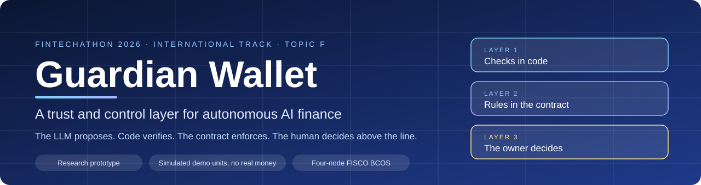
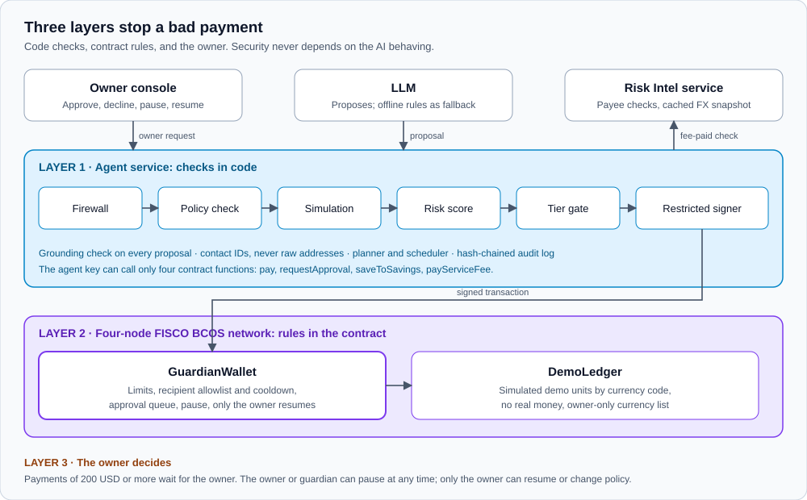

## FinTechathon 2026 submission (Team Entropy, Topic F)

| # | Submission item | Where |
|---|---|---|
| 1 | Technical documentation | [docs/TECHNICAL.md](https://github.com/kmsajid044-ship-it/guardian-wallet/blob/main/docs/TECHNICAL.md) |
| 2 | Presentation deck | [docs/Guardian_Wallet_Deck.pdf](https://github.com/kmsajid044-ship-it/guardian-wallet/blob/main/docs/Guardian_Wallet_Deck.pdf) |
| 3 | Demo video (2:04, captioned, no audio) | [docs/Guardian_Wallet_Demo.mp4](https://github.com/kmsajid044-ship-it/guardian-wallet/blob/main/docs/Guardian_Wallet_Demo.mp4) |
| 4 | Source code, README, deployment, tests | This repository; see [Quick start](https://github.com/kmsajid044-ship-it/guardian-wallet/blob/main/README.md#quick-start) |
| 5 | Security self-assessment | [docs/SECURITY_SELF_ASSESSMENT.md](https://github.com/kmsajid044-ship-it/guardian-wallet/blob/main/docs/SECURITY_SELF_ASSESSMENT.md) |
| 6 | Execution evidence (real on-chain transaction hashes, FISCO BCOS) | [docs/EXECUTION_EVIDENCE.md](https://github.com/kmsajid044-ship-it/guardian-wallet/blob/main/docs/EXECUTION_EVIDENCE.md) and [evidence/evidence.json](https://github.com/kmsajid044-ship-it/guardian-wallet/blob/main/evidence/evidence.json) |

- Live online demo: https://104-208-100-228.sslip.io
- Final report: [docs/FINAL_REPORT.md](https://github.com/kmsajid044-ship-it/guardian-wallet/blob/main/docs/FINAL_REPORT.md)
- Known limitations: [docs/KNOWN_LIMITATIONS.md](https://github.com/kmsajid044-ship-it/guardian-wallet/blob/main/docs/KNOWN_LIMITATIONS.md)

<p align="center">
  
</p>

<h1 align="center">Guardian Wallet</h1>

<p align="center">
  <b>Let AI handle your financial tasks, without giving up control of your money.</b><br>
  A research prototype for the 2026 Shenzhen FinTechathon, International Track, Topic F (Agent Wallet).
</p>

<p align="center">
  <a href="https://104-208-100-228.sslip.io"><b>Live demo</b></a> ·
  <a href="docs/USER_GUIDE.md">User guide</a> ·
  <a href="docs/DEMO_SCRIPT.md">Demo script</a> ·
  <a href="docs/EXECUTION_EVIDENCE.md">Evidence</a> ·
  <a href="docs/EVAL_REPORT.md">Evaluation</a> ·
  <a href="docs/FINAL_REPORT.md">Final report</a> ·
  <a href="docs/SECURITY_SELF_ASSESSMENT.md">Security</a>
</p>

> All balances are simulated demo units on a permissioned chain operated by the team. No real money or customer funds are involved.

**The LLM proposes. Code verifies. The contract enforces. The human decides above the line.**

---

## At a glance

| | |
|---|---|
| **134** transactions on a four-node FISCO BCOS network, each re-verified on all four nodes | **11 / 11** Attack Lab attacks blocked; 7 also refused when sent straight to the contract |
| **62** evaluation scenarios run on the chain, with **0** unsafe actions (see the limits below) | **4** contract functions are all the agent key can call |

## Start here (60 seconds)

| I want to | Go to |
|---|---|
| Try it now, nothing to install | [Online demo](https://104-208-100-228.sslip.io) |
| Follow a guided walkthrough | [docs/USER_GUIDE.md](docs/USER_GUIDE.md) |
| See the transactions and verify them | [docs/EXECUTION_EVIDENCE.md](docs/EXECUTION_EVIDENCE.md) |
| See how it was tested, including the weak spots | [docs/EVAL_REPORT.md](docs/EVAL_REPORT.md) and [docs/KNOWN_LIMITATIONS.md](docs/KNOWN_LIMITATIONS.md) |
| Run it myself | [Quick start](#quick-start) |

## Guardian Wallet in 30 seconds

You ask your AI to pay a friend.

- **"Pay Ana $50."** The agent checks the request, pays, and gives you a receipt you can verify against the chain.
- **"Pay Ana $250."** That is above your $200 approval line, so the AI waits for your OK.
- **"Send Ana $600."** That is above your $500 limit. The contract refuses it, and the refusal is recorded.
- **The AI is tricked, or its key is stolen.** The same limits still hold, because they are enforced by the contract and not by the AI.

The agent turns a chat request into a structured proposal, using a real LLM (optional) or offline rules. It works with contact IDs, never raw addresses. A grounding check rejects any amount, currency or contact that the request does not actually contain.

## Why this design

An AI that can move money cannot be trusted to police itself, so the limits live outside the AI. Three independent layers stand between a request and a payment:

| Layer | What it does | Who controls it |
|---|---|---|
| **1. Checks in code** | Injection firewall, policy pre-check, local simulation, explained risk score, permission tier | The agent service, deterministic code |
| **2. Rules in the contract** | The same policy enforced again on the chain: limits, recipient allowlist and cooldown, approval queue, pause | The `GuardianWallet` contract |
| **3. The owner decides** | Payments of 200 USD or more wait for the owner. The owner or guardian can pause everything; only the owner can resume | You |

Even a fully compromised agent key cannot exceed a limit, pay an unknown recipient, resume a paused wallet, or change its own policy.

<p align="center">
  
</p>

## What the competition brief asks for, and where to see it

| Capability | How it is shown | Evidence |
|---|---|---|
| **Intent understanding** | Chat request becomes a structured proposal; a grounding check rejects anything the request does not contain; ambiguous requests get one clarifying question | Clarification accuracy 15/15 in [docs/EVAL_REPORT.md](docs/EVAL_REPORT.md) |
| **Task planning** | Planner and scheduler modules turn requests into checked steps | [docs/TECHNICAL.md](docs/TECHNICAL.md) (Working / Partial / Planned) |
| **Safe execution** | Firewall, policy pre-check, simulation, risk score, tier gate, then the contract | Attack Lab 11/11 in [docs/ATTACK_LAB_EVIDENCE.md](docs/ATTACK_LAB_EVIDENCE.md) |
| **User control** | Approval for large payments, pause for the owner or guardian, owner-only resume and limits | Owner console: Home, Activity, Controls, Security |
| **Measurable value** | Automated evaluation, latency, and an estimated owner time saving | [docs/EVAL_REPORT.md](docs/EVAL_REPORT.md), [docs/FINAL_REPORT.md](docs/FINAL_REPORT.md) |

## Try it

Open the [online demo](https://104-208-100-228.sslip.io), or run it locally (see [Quick start](#quick-start)) and open <http://127.0.0.1:5173>. A short three-step tour runs on the first visit; the full walkthrough is in [docs/USER_GUIDE.md](docs/USER_GUIDE.md).

1. **Home**, tap `Pay Ana $50`: firewall, policy pre-check, simulation, risk score, executed. **View proof** shows the transaction; **Verify** asks the node for its receipt.
2. **Home**, tap `Pay Ana $250`: above the 200 approval line, so you see "Needs your OK" with Approve and Decline. Success appears only after the chain confirms.
3. **Home**, type `Send Ana $600`: "Blocked: $600.00 is above your $500 limit.", refused by the contract with a recorded hash.
4. **Home**, type `Pay someone`: the AI asks "Who should I pay?" with your contacts as buttons instead of guessing.
5. **Pause AI**: it asks first, then every page shows "Paused. The AI can't pay anyone." until the owner resumes.
6. **Security**: the Attack Lab (run all 11: injection, over-limit, split payments, unknown recipient, cooldown swap, approval replay, expired approval, agent resume, raw contract bypass, policy change, owner impersonation), the Evidence Inspector and Evaluation.

The console has four tabs: **Home**, **Activity** (everything the AI did, each row expandable to its proof and a "Why this action" panel), **Controls** (limits, recipients, pause and resume) and **Security** (for reviewers). The **Technical details** switch in the top bar shows backend codes, permission tiers, risk factors and hashes inline.

## Results

| What | Result | Source |
|---|---|---|
| Evaluation, 62 scenarios on FISCO BCOS (42 original + 20 held-out) | Task success 100% (62/62), unsafe action rate 0% (0/62), attack block rate 100% (29/29), clarification accuracy 100% (15/15) | [docs/EVAL_REPORT.md](docs/EVAL_REPORT.md) |
| Held-out scenarios (20, written from the docs only) | Before fixes: task success 80% (16/20), unsafe 0%, attacks blocked 77.8% (7/9). After general fixes all 20 pass within the 62-scenario run | [docs/EVAL_REPORT.md](docs/EVAL_REPORT.md) (Run history) |
| Agent latency | 219 ms average, 624 ms p95 over 60 requests, including on-chain confirmation | [docs/EVAL_REPORT.md](docs/EVAL_REPORT.md) |
| Estimated owner time saved | 47.9 min over 13 owner tasks (an estimate against stated manual baselines) | [docs/EVAL_REPORT.md](docs/EVAL_REPORT.md) |
| On-chain evidence | 134 FISCO BCOS transactions with receipts, all re-verified on all four nodes; a fresh-network replay reproduced 18/18 scenarios and 134/134 transaction effects; 7 off-chain blocks recorded with audit entries and no hash | [docs/EXECUTION_EVIDENCE.md](docs/EXECUTION_EVIDENCE.md) |
| Real language model (Groq, `openai/gpt-oss-120b`), same 62 scenarios | Run 1: task success 82.3% (51/62), unsafe 11.3% (7/62). Run 2, after a general grounding check: 100% (62/62), unsafe 0%. Independent check on 10 new scenarios: task success 90% (9/10), unsafe 0%, attacks 3/3 | [docs/LLM_EVIDENCE.md](docs/LLM_EVIDENCE.md) |
| Attack Lab | 11 of 11 attacks blocked; A2, A3, A6, A7, A8, A9 and A10 also refused when sent straight to the contract | [docs/ATTACK_LAB_EVIDENCE.md](docs/ATTACK_LAB_EVIDENCE.md) |

**How to read these numbers.** The first evaluation rows use the deterministic offline parser, so they measure the code that verifies, enforces and routes proposals, not a language model's understanding. The 100% rows include scenarios used while fixing the system, so they are not independent. The held-out scenarios were written from the documentation by the same assistant session that built the code, so they are not fully independent either. "0% unsafe" applies to these scenarios only.

## Online demo

**<https://104-208-100-228.sslip.io>**: the full owner console, with nothing to install.

- A four-node FISCO BCOS network (v3.16.4, chain ID 1337) runs in one container on an Azure VM operated by the team (Standard_B2als_v2, East Asia), together with the agent API, Risk Intel and the console. Every chain endpoint stays inside the container; only HTTPS is public.
- The chain starts fresh on every restart. **Reset demo** deploys fresh contracts and synthetic seed data, and the demo resets itself after 30 minutes without changes.
- Every visitor acts as the demo owner, so Approve, Pause and Resume work. The owner and agent keys are generated inside the container at start and never leave it.
- Proposals come from Ministral 8B via the Mistral API (`LLM_PROVIDER=mistral`, `MISTRAL_MODEL=ministral-8b-2512`). The demo falls back to the offline rules whenever the model is unavailable: quota used up, hourly call cap reached, or the provider fails. The AI label in the console names the model only after a call has succeeded and says "offline rules" otherwise. The grounding check still applies: an amount written in words is never guessed; "Pay Ana fifty USD" gets a request for digits, and "fifty dollars" (no currency code) gets a clarifying question.
- Chat is limited to 20 requests per minute per address; model calls are capped per hour.
- The recorded execution evidence comes from the team's own network and is in this repository, not on the online chain.

Checked on 2026-10-20 with `web/tests-hosted/online-demo.spec.ts` (on the `hosted-demo` branch) against the live URL: pay $50 and verify the FISCO BCOS receipt, $250 approved by the owner, $600 blocked, pause and resume, all Attack Lab attacks blocked, and Reset demo (7 of 7 passed). The container is built from `Dockerfile` and `hosted/` on the `hosted-demo` branch.

## Quick start

Prerequisites: Node.js 20+, pnpm 10, [Foundry](https://getfoundry.sh), `jq`, `curl`, `perl`, `openssl`, `xxd`, and a Java runtime (used by the FISCO BCOS console). The first run downloads the FISCO BCOS v3.16.4 node binary and console v3.8.0 from their official GitHub releases.

```bash
pnpm run setup && pnpm demo
```

`pnpm run setup` installs dependencies; creates a git-ignored `.env` with fresh test-only identities if none exists (keys are never printed); builds the contracts; starts the four-node FISCO BCOS network; and deploys and seeds the contracts if the recorded deployment has no code on this chain. `pnpm bootstrap` is an alias.

`pnpm demo` starts Risk Intel (8788), the agent API (8787) and the owner console (5173); Ctrl-C stops all three. `AGENT_PORT`, `RISK_INTEL_PORT` and `WEB_PORT` move them.

> **Known issue.** On a brand-new local network, setup can stop with `InsufficientFunds` because the network has not yet committed blocks. Run `pnpm run setup` again; if the chain still reports block 0, follow [docs/BLOCKERS.md](docs/BLOCKERS.md). The recorded evidence and the online demo do not depend on this.
>
> Use `pnpm run setup`, not `pnpm setup`: `setup` is a built-in pnpm command and always takes precedence over a package script with the same name.

For a clean demo state (for example before recording a video), one command resets everything:

```bash
./scripts/demo-reset.sh
```

It restarts the four nodes (ledger data kept), deploys fresh contracts, seeds synthetic balances and contacts, moves the previous audit log aside to `.demo/`, and starts the demo with the console on <http://localhost:3000>. The narration with exact clicks is [docs/DEMO_SCRIPT.md](docs/DEMO_SCRIPT.md).

### Real AI (optional)

Without a key the app runs fully on offline rules, and the top bar shows "AI: offline rules". To let a real LLM read requests with your own free Groq key:

1. Create a key at <https://console.groq.com/keys> and put it in `.env` (git-ignored): `GROQ_API_KEY=<your key>` and `LLM_PROVIDER=groq`.
2. Restart `pnpm demo`. The top bar now shows "AI: GPT-OSS 120B via Groq".

The model only proposes. Its JSON is validated with zod, and every proposal still passes the firewall, policy pre-check, simulation, risk score, tier gate and the contract. Invalid output is retried once and a rate limit up to three times with backoff; after that the request falls back to the offline rules and is marked "fallback", so a payment flow never fails because the LLM is down. `GROQ_MODEL` picks another model; Gemini works the same way with `LLM_PROVIDER=gemini` and `GEMINI_API_KEY`. Keys are read only from `.env` and never logged.

### Currencies

Demo units come from [`config/currencies.json`](config/currencies.json): ISO 4217 code, decimals, display name, and the seed amount minted at setup. The default is USD and CNY. `DemoLedger` stores balances by currency code and lists units through the owner-only `addCurrency`. Deployment, the agent, the parser, the console and the evaluation all read the same file, so adding an entry adds a currency without code changes (proven by `test_thirdCurrencyWorksWithoutCodeChanges` and `agent/src/exec/currency.e2e.test.ts`, which pays in SGD). Service fees are always USD. Policy limits are compared in minor units of the payment's currency, with no FX conversion.

### Deployment targets

| Target | Commands | Manifest |
|---|---|---|
| Local FISCO BCOS, four nodes, chain ID 1337 (primary) | `./scripts/chain-up.sh`, `./scripts/deploy-fisco.sh`, `./scripts/seed.sh` | `deployments/fisco.json` |
| Local Anvil, chain ID 31337 (development fallback) | `./scripts/dev-up.sh` | `deployments/local.json` |
| Clean demo state on FISCO BCOS | `./scripts/demo-reset.sh` | `deployments/fisco.json` |
| Hosted demo (Azure container) | `Dockerfile` and `hosted/` on the `hosted-demo` branch | `deployments/fisco.json` inside the container, rewritten on every start and Reset demo |
| Stop FISCO BCOS | `./scripts/chain-down.sh` | |

`CHAIN_BACKEND` (`fisco` or `evm-local`) selects the backend. The code connects only to chains operated by the team: startup rejects any RPC endpoint that is not loopback and any chain ID outside the backend's mapping. The hosted container follows the same rule: its four nodes run on the container's own loopback, and only the gateway on port 7860 (behind HTTPS) is reachable from outside. A production web build fails if the local demo owner key variable is set; deployed pages must sign owner actions with an injected browser wallet.

If agent requests hang after the network has been idle for a long time, the nodes may have stopped committing blocks: `./scripts/chain-down.sh && ./scripts/chain-up.sh` restarts them with their data intact. See the operational risk in [docs/SECURITY_SELF_ASSESSMENT.md](docs/SECURITY_SELF_ASSESSMENT.md).

## Tests and evidence

```bash
pnpm test                           # forbidden-content check, chain config check, every package's tests
pnpm lint
pnpm typecheck
pnpm --filter web test:e2e          # Playwright owner-console tests
cd contracts && forge test -vv      # unit, fuzz, and invariant tests I1-I8
pnpm --filter agent test:parity     # agent pre-check vs contract on both backends (needs FISCO running)
pnpm eval                           # all 62 scenarios; writes eval/results.json and docs/EVAL_REPORT.md
pnpm attacks                        # 11 Attack Lab scenarios; `pnpm attacks A2 A9` or `--api` for the running agent
pnpm evidence                       # on-chain execution evidence on FISCO BCOS; exports evidence/
pnpm verify-evidence --running      # re-fetch every exported hash from all four nodes
pnpm verify-evidence --fresh        # new four-node network, deploy, replay, compare
pnpm licenses:doc                   # regenerate docs/LICENSES.md
```

More options (held-out suites, recorded runs, real-LLM runs) are listed in [docs/EVAL_REPORT.md](docs/EVAL_REPORT.md).

## Project structure

```
contracts/   Solidity: GuardianWallet (policy controller) and DemoLedger (simulated ledger); Foundry tests
agent/       TypeScript service: LLM adapters, firewall, policy pre-check, simulation, risk score,
             tier gate, restricted signers (src/exec/), planner, scheduler, audit chain, Attack Lab, HTTP API
risk-intel/  Synthetic payee checks and a cached USD/CNY FX snapshot, released after a verified fee receipt
web/         Owner console: Home, Activity, Controls, Security (Attack Lab, Evidence Inspector, Evaluation)
eval/        Evaluation scenarios (eval/scenarios/*.yaml) and harness
evidence/    Exported FISCO BCOS receipts, evidence.json, and a node data snapshot
scripts/     Setup, demo, chain, deployment, evidence, and repository checks
docs/        Technical design, security self-assessment, threat model, reports, licenses
```

## Documentation

| Document | What is in it |
|---|---|
| [SPEC.md](SPEC.md) and [docs/TECHNICAL.md](docs/TECHNICAL.md) | Design, including what is Working, Partial and Planned |
| [docs/SECURITY_SELF_ASSESSMENT.md](docs/SECURITY_SELF_ASSESSMENT.md) | Permission tiers T0-T3 and the known-risk list |
| [docs/THREAT_MODEL.md](docs/THREAT_MODEL.md) | Threat model |
| [docs/EVAL_REPORT.md](docs/EVAL_REPORT.md) and [docs/LLM_EVIDENCE.md](docs/LLM_EVIDENCE.md) | Evaluation, run history and raw real-model output |
| [docs/ATTACK_LAB_EVIDENCE.md](docs/ATTACK_LAB_EVIDENCE.md) | Every attack and the layer that stopped it |
| [docs/EXECUTION_EVIDENCE.md](docs/EXECUTION_EVIDENCE.md) | The recorded on-chain transactions and how to verify them |
| [docs/FINAL_REPORT.md](docs/FINAL_REPORT.md) | Summary built only from the committed reports |
| [docs/KNOWN_LIMITATIONS.md](docs/KNOWN_LIMITATIONS.md) and [docs/BLOCKERS.md](docs/BLOCKERS.md) | What does not work yet, in plain words |
| [docs/SUBMISSION_CHECKLIST.md](docs/SUBMISSION_CHECKLIST.md) | Competition checklist |
| [docs/LICENSES.md](docs/LICENSES.md) and [THIRD_PARTY_NOTICES.md](THIRD_PARTY_NOTICES.md) | Third-party licenses |

## Limitations

- On a brand-new local FISCO BCOS network the setup script can stall; see [docs/BLOCKERS.md](docs/BLOCKERS.md).
- The held-out scenarios are not fully independent, and the 100% rows include scenarios used while fixing the system.
- Whether the organizers accept transaction hashes from a team-operated permissioned chain as evidence has not been confirmed. `pnpm verify-evidence --fresh` lets anyone reproduce the results on a fresh network of their own.
- All contacts, payees and risk results are synthetic. FX is a read-only cached snapshot for reference; no amount is computed from it.

## Compliance note

- Research prototype. Simulated ledger with USD and CNY demo balances only; demo units have no value and there is no real money.
- CNY balances: Simulated demo units denominated in CNY for illustration. No value, not issued, not redeemable, not a digital currency, not linked to e-CNY.
- The code connects only to chains operated by the team, always on a loopback endpoint (the local FISCO BCOS network, the same network inside the hosted demo container, or a local development chain), and never to an external chain or public RPC endpoint.
- Signing keys exist only in the git-ignored `.env` or are generated inside the hosted container. `.env.example` holds placeholders. The agent signing key is read only under `agent/src/exec/`, and a test enforces this.

## Team

Guardian Wallet was designed by **Team Entropy**: K.M. Sajidul Haq, Tanjimul Astak Siam and Farhan Al Nahian. It was implemented with AI coding assistants under our direction. Every result in this repository (tests, evaluation reports, Attack Lab results and on-chain evidence) was produced by the scripts in this repository and can be re-run from them.

## License

MIT. Third-party licenses: [docs/LICENSES.md](docs/LICENSES.md).
