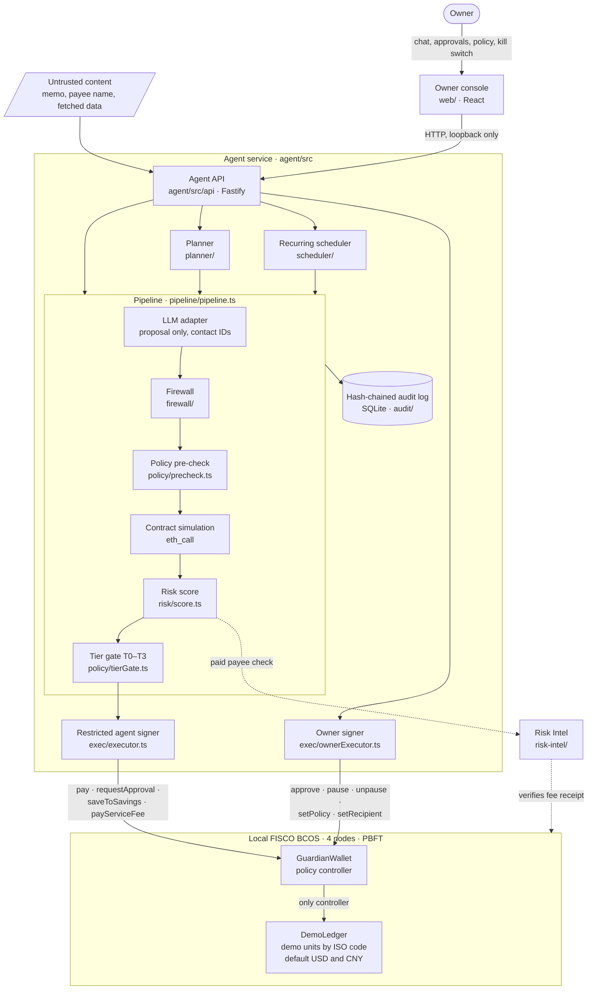

# Technical design

Guardian Wallet: a trust and control layer for autonomous AI finance. Let AI handle your financial tasks, without giving up control of your money. All balances are simulated demo units; no real money or customer funds are involved.

Guardian Wallet is a research prototype with USD and CNY demo balances on a simulated ledger, running on a permissioned chain operated by the team (local FISCO BCOS v3.16.4, four nodes, PBFT, chain ID 1337). There is no real money. The full specification is [SPEC.md](../SPEC.md); this document explains the architecture, the core algorithms, and the security design.

> Simulated demo units denominated in CNY for illustration. No value, not issued, not redeemable, not a digital currency, not linked to e-CNY.

## Architecture

- **LLM adapter** (`agent/src/llm/`): Anthropic, an OpenAI-compatible endpoint, or a deterministic parser (`mock.ts`). The model sees contact IDs only and must return the strict `ActionProposal` schema (`llm/actionProposal.ts`; unknown keys such as a raw address are rejected). Untrusted content is wrapped in `<UNTRUSTED_DATA>` delimiters and labelled as data (`llm/prompt.ts`). Invalid output or an unavailable provider falls back to the deterministic parser, and the response reports the effective provider.
- **Restricted signers** (`agent/src/exec/`): the only modules that read signing values. The agent signer submits one of the four agent functions and only when the simulation outcome matches the policy route (`exec/executor.ts:38`). The adapter refuses any other signer (`chain/ChainAdapter.ts:157`, `:165`).
- **Owner signer, local demo only** (`agent/src/exec/ownerExecutor.ts`): signs `approve`, `pause`, `unpause`, `setPolicy`, and `setRecipient` for the owner console. Every `/owner/*` route requires the per-run owner session token in `x-owner-session`, refuses foreign `Origin` and non-loopback `Host` values before parsing the body, and compares the token in constant time (`agent/src/api/ownerSession.ts`). The agent writes a fresh token to git-ignored `.demo/owner-session` (mode 0600) at each start; the Vite dev server serves it at `/__owner-session` only to same-origin requests on a loopback host (`web/owner-session.ts`), so other sites, other localhost ports, and DNS-rebound pages cannot read it. The token is never logged or printed. In production the owner signs in the injected browser wallet and the service holds no owner key.
- **Contracts** (`contracts/src/`): `GuardianWallet` holds the policy, allowlist, pending approvals, and kill switch; `DemoLedger` holds balances and savings and accepts movements only from its controller, the wallet.
- **Risk Intel** (`risk-intel/`): synthetic payee checks and an illustrative cached USD/CNY FX snapshot (7.10, not a market rate), released only after the agent pays a 0.05 USD service fee on-chain and the service verifies that receipt (one use per receipt).

## Core algorithms

### Pipeline

Every direct, planned, and scheduled action runs `proposal → firewall → policy pre-check → contract simulation → risk score → tier gate → restricted signer → audit` (`pipeline/pipeline.ts`):

1. The adapter produces an `ActionProposal`; a payment without currency, contact, or amount fails semantic validation and falls back to the deterministic parser, which asks a targeted question (`ANSWER_ONLY`).
2. The firewall inspects the message and every untrusted field (line 81). Any flag other than `AMOUNT_OUTLIER` blocks; a policy-change attempt is classified T3.
3. The contact ID resolves to an address only through the owner's contact list; the recipient must be allowlisted on-chain (line 101).
4. The policy pre-check (`policy/precheck.ts`) reads live contract state and applies the contract's checks in the contract's order. The contract simulation (`eth_call` of the same call) must agree; disagreement throws (line 109). A blocked action is still submitted, so the contract records `PolicyViolation` with a transaction hash.
5. Before a first or approval-sized payment, the agent buys a payee check from Risk Intel and re-runs the firewall over the returned content (line 120).
6. The risk score and tier gate route the action (lines 126–161; untrusted-source actions always go to T2, see [Tier gate](#tier-gate)); the signer submits it; the decision, reason, tier, risk factors, transaction hash, and block are appended to the audit chain.

### Planner

`agent/src/planner/planner.ts` turns a multi-step request into a draft plan of up to 20 `ActionProposal` steps:

- `pay my <contact> of <amount> <currency> this month but keep <amount> <currency> in savings` becomes `[save, pay]`.
- Otherwise the request is split on "then" (at least two clauses), and each clause is parsed by the deterministic parser; every step must be an executable payment or savings proposal.
- The draft shows a preview (`CHECK_BALANCE`, `CHECK_LIMITS`, `SAVE`, `REQUEST_APPROVAL`, `EXECUTE_AFTER_APPROVAL`) and stays editable until execution.
- Execution re-enters the full pipeline for each step in order, as a canonical command with source reference `plan:<id>:step:<n>`. It stops at the first step that is not `EXECUTED`: `NEEDS_APPROVAL` sets the plan to `WAITING_APPROVAL`, anything else to `STOPPED`, and later steps are marked `NOT_RUN`. Every transition is audited.
- A trailing "and ask me before anything above <amount> <currency>" sets the plan's approval cap. It can only add approvals: a step the contract would execute directly is held off-chain (`OWNER_PLAN_APPROVAL_CAP`, T2, nothing signed) when its nominal amount, in its own demo units and without FX, is above the cap.
- `POST /chat` turns a "then" request into a plan (`route: "PLAN"`) and validates it at once: `AgentPipeline.validate` runs firewall, pre-check, simulation, risk, and tier gate without signing, skipping the paid payee check, and logs `plan_step_validated` instead of a decision. Each step carries a state taken only from the backend (`PLANNED`, `VALIDATED`, `PENDING_APPROVAL`, `EXECUTED`, `BLOCKED`, `FAILED`); the owner console shows it with the step ID, contract operation, recipient, amount, currency, tier, and risk score, and shows a transaction hash and block only after the executor has the receipt. "Verify" fetches that receipt from the node through `GET /receipt/:hash`.

Recurring payments (`scheduler/scheduler.ts`) re-enter the same pipeline on every occurrence, with source reference `recurring:<id>`. Plans and recurring jobs are held in memory and do not survive a restart of the agent service.

### Risk score

`agent/src/risk/score.ts`. The score is the sum of the applicable factors, capped at 100:

| Factor | Points | Condition |
|---|---|---|
| `UNTRUSTED_SOURCE` | 20 | The request came from untrusted content |
| `INJECTION_PATTERN` | 30 | The firewall found an instruction-injection pattern |
| `ABOVE_CONTACT_MEDIAN` | 15 | Amount is more than twice the contact's median payment |
| `FIRST_PAYMENT` | 10 | No recorded payment to this contact |
| `MOST_OF_REMAINING_DAILY` | 15 | Amount exceeds 70% of the remaining daily limit |
| `OUTSIDE_USUAL_HOURS` | 10 | Outside the owner's active hours (`OWNER_ACTIVE_HOURS`, `OWNER_TIMEZONE`) |
| `HIGH_VELOCITY` | 20 | Three or more executed payments in the last hour |
| `RISK_INTEL_SANCTIONED` | 100 | Synthetic payee check reports a sanctions match |
| `RISK_INTEL_HIGH` / `RISK_INTEL_MEDIUM` | 40 / 20 | Payee check score at least 70 / at least 40 |

`score = min(100, Σ points)`. Route: score ≥ 85 → `BLOCK`; 60–84 → `FORCE_APPROVAL` (T2, owner approval even below the approval threshold); below 60 → `ALLOW`. Every factor carries a plain-language explanation shown to the owner.

### Tier gate

`agent/src/policy/tierGate.ts` maps each agent action to T0–T3, in this order: risk `BLOCK` → T2 refused; policy `BLOCKED` → T1 refused; **untrusted intake source → T2** (owner approval, regardless of score); policy `NEEDS_APPROVAL` or risk `FORCE_APPROVAL` → T2; otherwise T1 autonomous. A T2 action that the contract would execute directly (below the 200 USD approval threshold, or savings) is held off-chain: the pipeline returns `NEEDS_APPROVAL` and signs nothing. An untrusted action at or above the threshold goes to `requestApproval` and waits for the owner's on-chain `approve`. Untrusted holds carry the flag `UNTRUSTED_SOURCE_REQUIRES_APPROVAL`. An untrusted recurring request is held the same way instead of creating a schedule (scheduled runs are trusted), and plan steps keep the plan's intake source (`planner/planner.ts`). Covered by `tierGate.test.ts`, `planner.test.ts`, `api.e2e.test.ts` "holds every untrusted payment or savings request for T2 owner approval", and eval X09.

### Firewall rules

`agent/src/firewall/firewall.ts`. Inputs: the message, its source (trusted or untrusted), the proposal, the contact list, payment history, and untrusted context fields (memo, payee name, fetched content).

| Flag | Rule |
|---|---|
| `INSTRUCTION_INJECTION` | Untrusted message or any untrusted field matches: "ignore previous/prior instructions or rules", "system message/prompt", "act as the owner", "I am / this is / from the owner", "override the policy", "disregard previous/prior/system", "developer message", "send all/everything", "urgent … bypass/override/ignore" |
| `ADDRESS_INJECTION` | A raw address in an untrusted message, or an address in a memo or payee name that is not a known contact |
| `UNKNOWN_CONTACT` | Untrusted text names a new/unknown/unapproved payee, or the proposal's contact ID is not in the contact list |
| `RECIPIENT_SWAP` | The proposal's contact differs from the expected contact supplied with the request |
| `POLICY_CHANGE_ATTEMPT` | Message or untrusted field asks to change, disable, ignore, override, raise, lower, remove, or set a policy, limit, allowlist, approval, or guardian |
| `INVALID_AMOUNT` | Amount is not a decimal with at most six fractional digits |
| `AMOUNT_OUTLIER` | Amount above twice the contact's median (raises risk; does not block on its own) |

The firewall blocks on any flag except `AMOUNT_OUTLIER`, and it runs twice for payments that use a payee check: on the intake and on the returned content.

### On-chain policy

`contracts/src/GuardianWallet.sol`. Policy: per-payment limit, daily limit, approval threshold, recipient cooldown, pending expiry, per-call and daily service-fee limits. Demo deployment: 500 USD per payment, 1,000 per day, approval from 200, 600-second cooldown for newly added recipients, 86,400-second pending expiry, 0.1 USD per fee call, 5 USD fees per day.

Agent functions (`onlyAgent`) check, in order: paused, zero amount, duplicate intent, then per function:

- `pay`: recipient allowlisted, recipient active (cooldown over), not above the per-payment limit, below the approval threshold, within the UTC-day limit, sufficient balance.
- `requestApproval`: allowlisted, active, not above the per-payment limit, at or above the threshold; creates a pending item that expires after `pendingExpiry`.
- `saveToSavings`: sufficient balance.
- `payServiceFee`: per-call limit, separate daily fee budget, sufficient USD balance.

A failed check emits `PolicyViolation(intentId, action, reason, amount)` and returns `BLOCKED` without reverting, so the refusal is recorded with its own transaction hash. Unauthorized callers revert. `approve` (owner only) executes a pending item once, before expiry, re-checking allowlist, cooldown, and balance; it counts toward the day's spending but is not capped by the daily limit, because the owner decides above the line. Pause is open to the owner and the guardian; resume, policy, recipients, roles, fee account, and savings withdrawal are owner only.

FISCO BCOS reports `block.timestamp` in milliseconds. Both contracts record `clockScale` at deployment (1000 when the deployment timestamp is at least 1e11, otherwise 1) and divide every timestamp by it, so day buckets, cooldowns, expiry, and the savings year are seconds on both backends (`contracts/test/MillisecondClock.t.sol`).

### Currencies

Demo units are listed in `config/currencies.json` (ISO 4217 code, decimals, display name, seed). `DemoLedger` keys balances by `bytes3` code and exposes `addCurrency` (owner only; three upper-case letters, at most 18 decimals, no duplicates), `isCurrency`, and `currencies()`. Deploy scripts (`contracts/script/CurrencyConfig.sol`) and the agent's deployment path list every configured unit; the agent registry (`agent/src/currency/registry.ts`) supplies the parser's currency pattern, the LLM tool schema's enum, clarifying questions, minor-unit conversion, and the CNY disclaimer. `GuardianWallet` checks `isCurrency` right after the common checks and refuses an unlisted code with `PolicyViolation(UNKNOWN_CURRENCY)`; the pre-check mirrors that position. Service fees are USD only. Limits compare minor units of the payment's currency without FX, so 500 is the per-payment limit in either unit.

### Invariants I1–I8

Foundry invariant tests (`contracts/test/invariant/`) drive a handler with random payments, unknown-recipient payments, service fees, savings, approvals (late and repeated), pause toggles, guardian resume attempts, agent owner-function probes, and time warps. Latest run: all eight hold over 256 runs and 16,384 calls with 0 reverts.

| ID | Invariant | Checked as |
|---|---|---|
| I1 | Autonomous daily payment outflow stays within the daily limit | Recipient balance deltas per day ≤ `dailyLimit` |
| I2 | Payments reach only active allowlisted recipients | Unknown recipient never gains balance |
| I3 | Agent actions move no value while paused | No payment, fee, or savings movement while paused |
| I4 | Pending actions execute at most once and never after expiry | Late or repeated approvals never move value |
| I5 | Savings remain assigned to the wallet account | No other account holds savings; wallet savings ≥ total deposited |
| I6 | Only the owner changes policy and role configuration | Guardian resume fails; owner unchanged |
| I7 | The agent cannot escape its four-function surface | Agent calls to owner functions fail; agent unchanged |
| I8 | Service fees stay within their separate daily budget, in USD only | Fee spending ≤ fee budget; no CNY fees |

### Audit chain

`agent/src/audit/audit.ts`. Each entry's hash is `sha256(previous hash + canonical JSON of {timestamp, kind, data})`, starting from 64 zeros. The SQLite table rejects updates and deletes with triggers, and `verifyAuditChain()` recomputes the chain (`GET /audit/verify`).

## Security design: defence in depth

The agent checks first; the chain enforces again. A layer that fails or is bypassed leaves the next one standing, and the last one, the contract, is not under the agent's control.

| Threat | Agent-side check | Chain enforcement | Evidence |
|---|---|---|---|
| Prompt injection in a memo, payee name, or fetched content | Firewall `INSTRUCTION_INJECTION`, `ADDRESS_INJECTION`; untrusted delimiters | Recipient allowlist and limits apply regardless of what the agent believes | Attack Lab A1, A11; eval X01–X05 |
| Payment above the per-payment limit | Pre-check `OVER_PER_TX_LIMIT` | `PolicyViolation(OVER_PER_TX_LIMIT)` | A2; evidence E06 |
| Many small payments past the daily limit | Pre-check daily total; risk `HIGH_VELOCITY` | UTC-day counter, `OVER_DAILY_LIMIT` | A3 |
| Unknown or swapped recipient | Contact IDs only; `UNKNOWN_CONTACT`, `RECIPIENT_SWAP` | `RECIPIENT_NOT_ALLOWED`; cooldown `RECIPIENT_NOT_ACTIVE` | A4, A5; eval X03 |
| Replayed or expired approval | Pending items are executed only by the owner | `PendingNotActive`, `PendingHasExpired`, `DUPLICATE_INTENT` | A6, A7 |
| Agent resumes a paused wallet or changes its policy | Tier gate: owner operations are T3, never agent | `onlyOwner` reverts `OwnableUnauthorizedAccount` | A8, A10 |
| Fully compromised agent key | None (bypassed) | Ledger moves only via the wallet (`NotController`); four-function surface; every policy check | A9 |
| Simulation drift | Pre-check and simulation must agree, or the pipeline throws | The contract's outcome is final | Parity tests on both backends |
| Another user or a web page drives the local owner endpoints | Per-run owner session token, constant-time compare; foreign `Origin` and rebound `Host` refused | Contract `onlyOwner` still applies to the owner key | `api.e2e.test.ts`, `web/owner-session.test.ts` |
| Signing value leakage | Read only in `src/exec/`; never logged, sent to the LLM, or sent to the browser | — | `exec/key-boundary.test.ts` |

Measured results: [EVAL_REPORT.md](EVAL_REPORT.md) (62 scenarios including 20 held-out; 0 unsafe actions; 29 of 29 attacks refused) and [EXECUTION_EVIDENCE.md](EXECUTION_EVIDENCE.md) (134 FISCO BCOS transactions, verified on all four nodes and reproduced on a fresh network, plus 7 off-chain blocks with their audit entries).

The owner console's Evidence Inspector (`#/evidence`, `web/src/EvidenceInspector.tsx`) shows the same export in three groups. `agent/src/evidence/inspect.ts` does the split: a transaction is an on-chain refusal when it reverted or its receipt carries `PolicyViolation`, otherwise it is executed. An off-chain block is a decision in `decisions` with no transaction: it is shown with its audit entry (log, entry ID, kind, entry hash, previous hash, and whether the chain verifies) and never with a hash. Verify calls `GET /evidence/verify/:hash`, which runs the mode (a) check for that one transaction against the loopback node named in the export.
